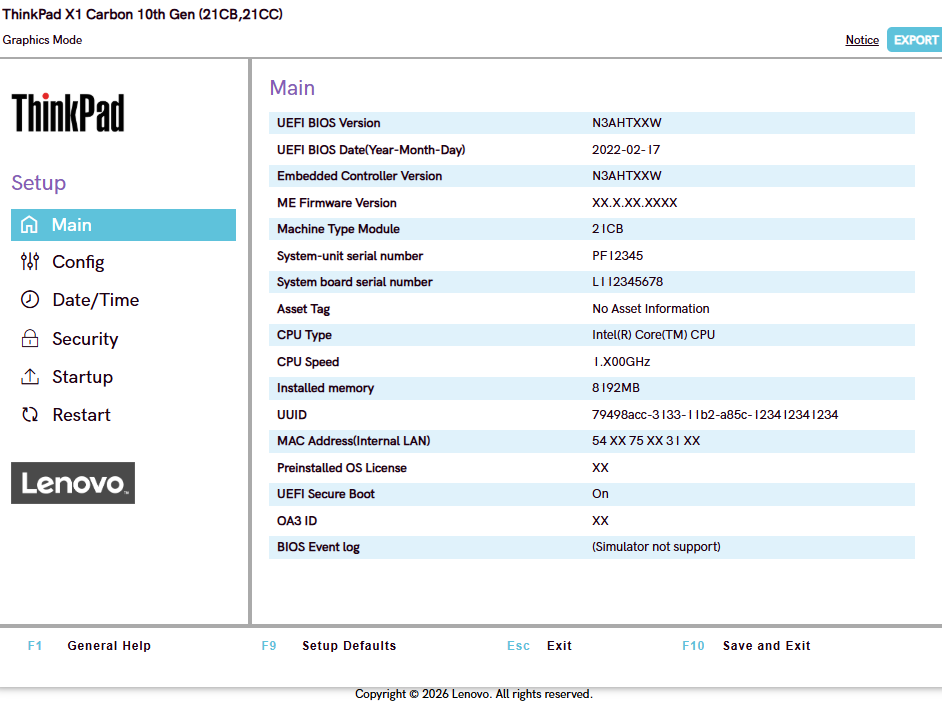
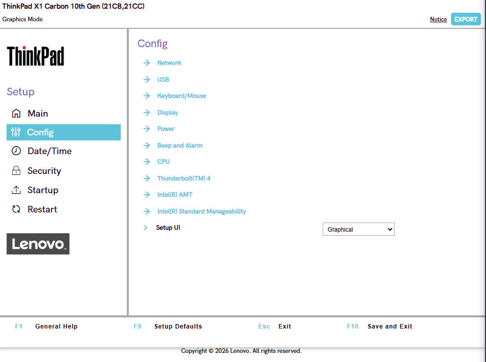
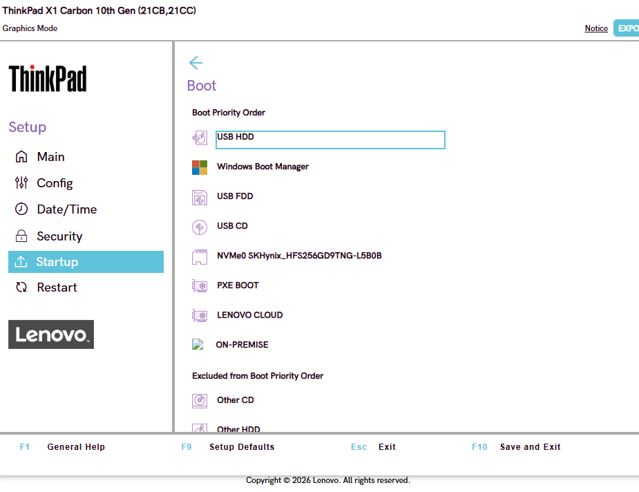
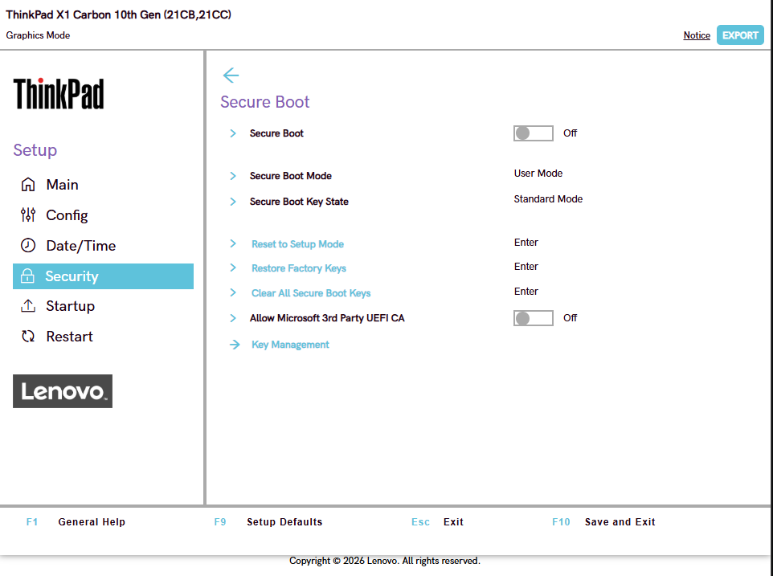
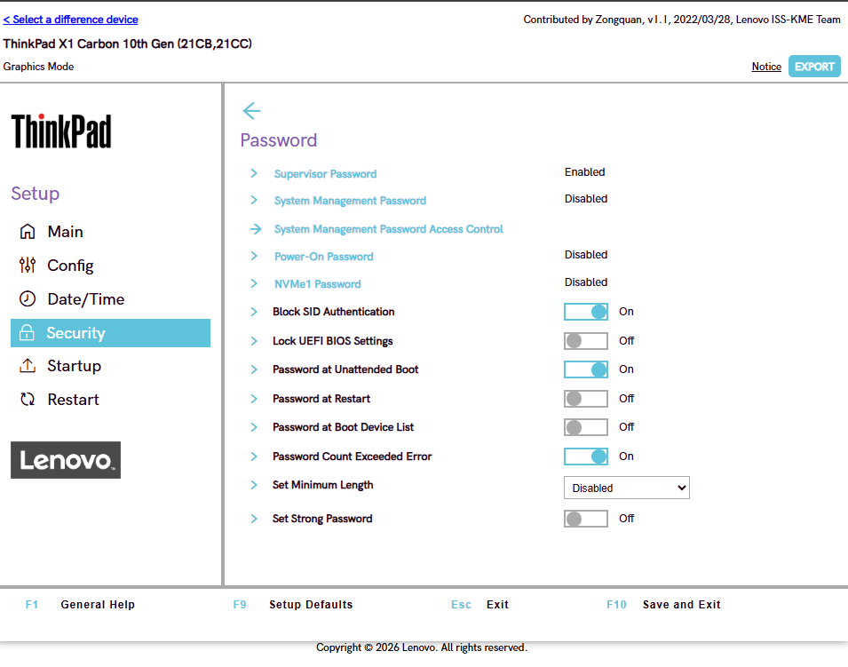
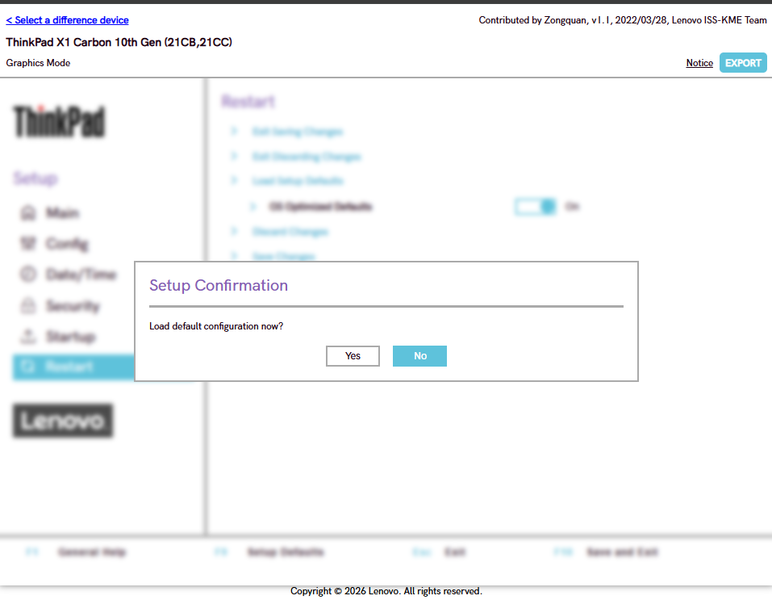
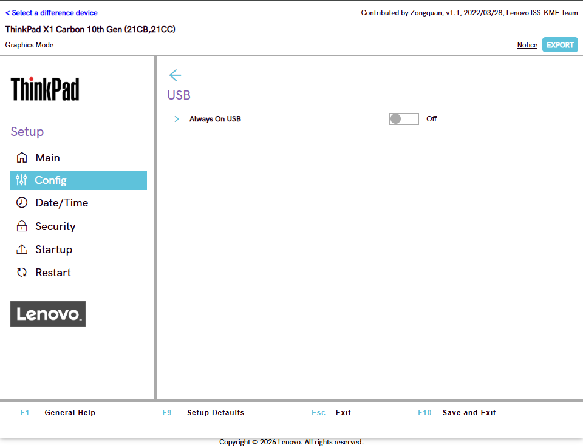
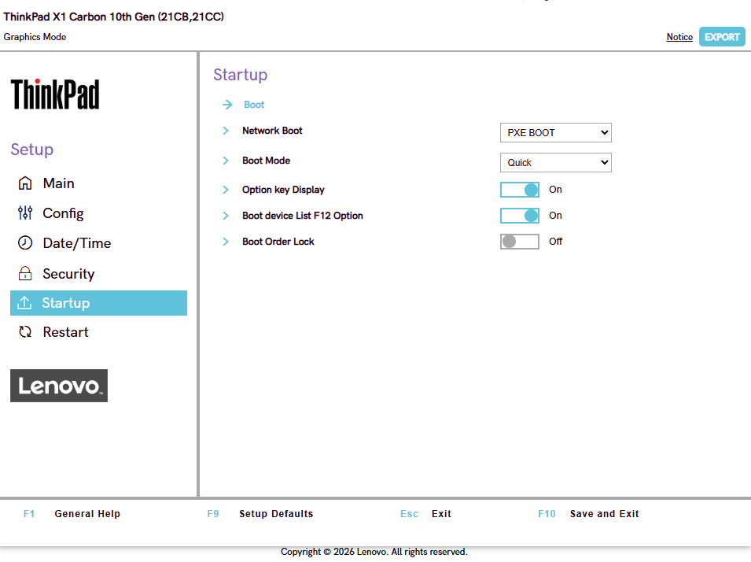

# Отчёт: отработка BIOS/UEFI в Lenovo BIOS Simulator Center

**Симулятор:** https://download.lenovo.com/bsco/index.html
**Устройство:** ThinkPad X1 Carbon 10th Gen (21CB, 21CC), графический режим
**Версия UEFI BIOS:** N3AHTXXW от 2022-02-17

---

## Задача 1. Навигация по основным разделам

Просмотрены разделы **Main**, **Config**, **Date/Time**, **Security**, **Boot**, **Restart**.

* **Main** — информация об устройстве:
    * UEFI BIOS Version: N3AHTXXW, дата 2022-02-17
    * Embedded Controller Version: N3AHTXXW
    * Machine Type Module: 21CB
    * серийные номера: системного блока (PF12345) и системной платы (L112345678)
    * CPU Type: Intel(R) Core(TM) CPU, 1.X00GHz
    * Installed memory: 8192MB
    * UUID, MAC-адрес внутренней сетевой карты
    * UEFI Secure Boot: On
    * BIOS Event log (в симуляторе не поддерживается)

  

* **Config** — настройки устройств: Network, USB, Keyboard/Mouse, Display, Power, Beep and Alarm, CPU, Thunderbolt 4, Intel AMT, Intel Standard Manageability, Setup UI.

  

* **Date/Time** — настройка системной даты и времени.
* **Security** — Password (пароль для входа в BIOS или на включение ноутбука), Fingerprint, Security Chip, UEFI BIOS Update Option, Memory Protection, Virtualization, I/O Port Access, Internal Device Access, Secure Boot, Device Guard, ThinkShield secure wipe, Reset system to Factory Default и др.
* **Boot** — выбор, откуда загружается ОС (порядок загрузки, Boot Mode, F12-меню, Boot Order Lock).
* **Restart** — выход с сохранением / без сохранения изменений, Load Setup Defaults, OS Optimized Defaults, Discard Changes, Save Changes.

**Итог:** структура меню изучена, расположение настроек из задач 2–5 известно.

---

## Задача 2. Смена порядка загрузки

**Путь:** `Boot → Boot Order` (в данной версии раздел называется Boot, а не Startup).

USB-устройство поставлено первым, NVMe — вторым. Сохранение изменений — клавиша **F10** (или `Restart → Save Changes`). Порядок отображается в том же разделе Boot после повторного входа в BIOS.

---

## Задача 3. Включение/выключение Secure Boot

**Путь:** `Security → Secure Boot → Secure Boot` (статус также виден в `Main → UEFI Secure Boot`).

Исходный статус — **On**. Значение переключено на противоположное, затем возвращено обратно.

**Назначение Secure Boot:** защита от загрузки неподписанного или вредоносного кода (буткитов, руткитов). UEFI проверяет цифровую подпись загрузчика ОС и драйверов, и если подпись недоверенная, загрузка блокируется. Это важно, например, при установке Linux или старых ОС без подписанного загрузчика — тогда Secure Boot приходится отключать.

---

## Задача 4. Установка пароля супервизора

**Путь:** `Security → Password → Supervisor Password`.

Установлен пароль `Test1234`. При попытке войти в BIOS / изменить настройки запрашивается пароль. После проверки пароль снят.

---

## Задача 5. Сброс на заводские настройки

**Путь:** `Restart → Load Setup Defaults` (также есть `Security → Reset system to Factory Default`; в симуляторе используется клавиша **F9**).

Сброс подтверждён, настройки из задач 2–4 вернулись к исходным значениям.

---

## Задача 6. Управление встроенными устройствами

**Путь:** `Config → USB`.

Найдены параметры USB (в т.ч. поддержка USB и Always On USB). Параметр отключён, затем включён обратно. USB-поддержка на уровне UEFI отключается именно в этом разделе. Также управление портами доступно в `Security → I/O Port Access`.

---

## Задача 7. Режим работы SATA/NVMe

В данном ноутбуке (симуляторе) такой настройки нет: в разделе Config отсутствуют пункты Storage / SATA Controller Mode.

**Теоретически:** основные режимы контроллера — **AHCI**, **RAID (Intel RST)**. Риск смены режима: уже установленная ОС может перестать загружаться (синий экран, `INACCESSIBLE_BOOT_DEVICE` в Windows), поскольку в ней нет нужного драйвера контроллера.

---

## Задача 8. Временное меню загрузки (эмуляция F12)

**Путь:** `Boot → Boot device List F12 Option` (значение **On**) и `Boot → Boot Mode`.

Меню F12 вызывается при включении ноутбука и позволяет выбрать устройство загрузки **один раз**, не меняя сохранённый порядок загрузки. Постоянный порядок (задача 2) действует при каждом запуске.

---

## Задача 9. Просмотр системных логов

Симулятор не поддерживает: в `Main` пункт **BIOS Event log** помечен как «Simulator not support», очистить журнал событий нельзя.

**На реальном устройстве:** журнал событий доступен в разделе Main (BIOS Event log) или в Config / Diagnostics, там же находится функция очистки журнала.

---

## Задача 10. Полный сценарий: подготовка к переустановке ОС

Шаги выполнены последовательно:

1. Сброс настроек на Factory Defaults (`Restart → Load Setup Defaults`, F9).
2. Включение Secure Boot (`Security → Secure Boot`).
3. Установка Supervisor Password (`Security → Password → Supervisor Password`).
4. USB поставлен первым в порядке загрузки (`Boot → Boot Order`).
5. Сохранение и выход (F10).
6. Повторный вход в BIOS: настройки проверены, пароль сброшен, порядок загрузки возвращён.

Все настройки после повторного входа совпали с ожидаемыми.

---

## Вывод

Освоены основные разделы UEFI ThinkPad X1 Carbon: навигация, смена порядка загрузки, Secure Boot, пароль супервизора, сброс настроек, управление USB и временное меню загрузки. Настройки SATA/NVMe и журнал событий в симуляторе недоступны. На реальном устройстве названия пунктов могут немного отличаться, но логика остаётся той же.
