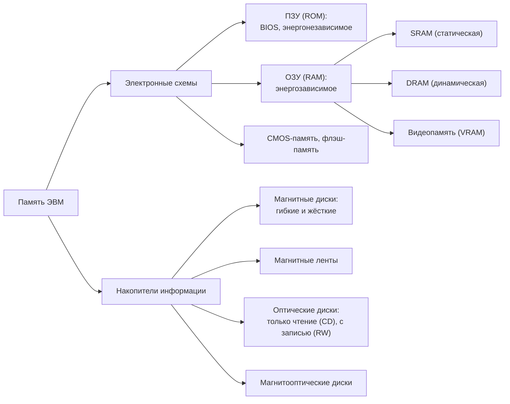
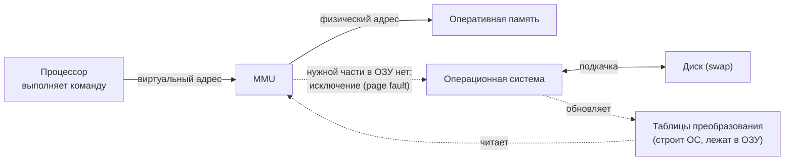
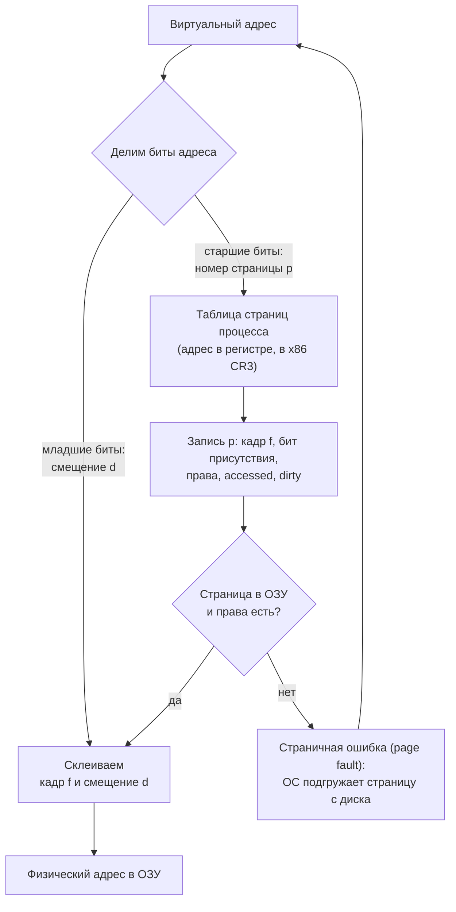
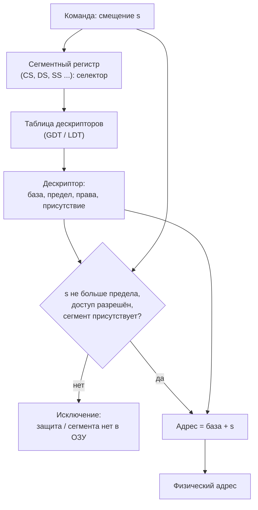
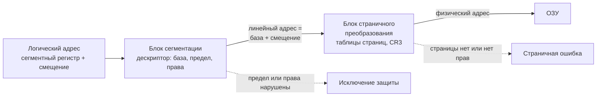
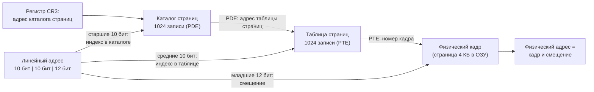
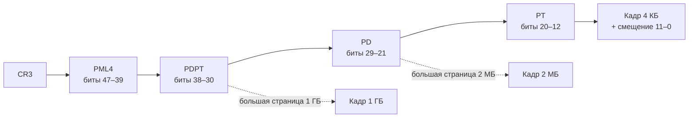
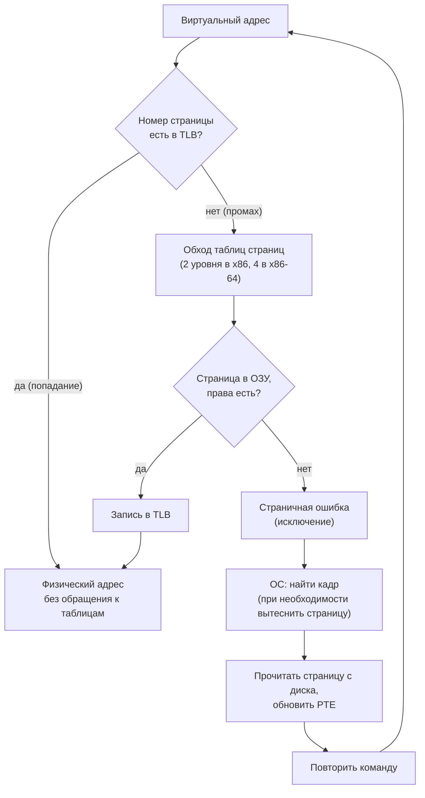
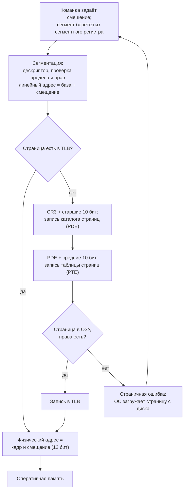

# Домашняя работа 5
> Подробный конспект и сделать схему работы виртуальной памяти по сегментной страничной архитектуре

# Память компьютера: виды, иерархия и виртуальная память

## 1. Виды памяти и иерархия

Память компьютера устроена как иерархия: чем быстрее уровень, тем он дороже и меньше по объёму. Виртуальная память — механизм на стыке двух нижних уровней: ОЗУ и диска.

| Уровень | Примеры | Скорость | Объём | Энергонезависимость |
| --- | --- | --- | --- | --- |
| Регистры | регистры процессора | самая высокая | десятки значений | нет |
| Кэш | L1, L2, L3 (SRAM внутри процессора) | очень высокая | килобайты — десятки мегабайт | нет |
| Оперативная память | ОЗУ (RAM), DRAM | высокая | гигабайты | нет |
| Внешняя память | SSD, жёсткий диск, ленты, оптические диски | низкая | сотни гигабайт — терабайты | да |

### 1.1. Устройство памяти: бит, ячейка, слово, адрес

Память состоит из двоичных запоминающих элементов — битов. Физически оперативная память линейна: это последовательность ячеек (байтов, 1 байт = 8 бит) с номерами от 0 до N. Номер ячейки — её адрес.

- **Слово** — единица обмена между оперативной памятью и процессором; её размер определяется разрядностью процессора. В ранних ЭВМ ячейки были одно-двухбайтовыми (полуслова); В современных машинах слово — 4 последовательных байта (для 64-разрядного процессора — 8 байт).
- **Блок** — непрерывная область памяти с общим ключом защиты; процессу выдаётся память, кратная размеру блока.
- **Сегмент** — некоторый участок памяти, может содержать несколько блоков.
- **Единицы объёма:** 1 КБ = 1024 Б, 1 МБ = 1024 КБ, 1 ГБ = 1024 МБ, 1 ТБ = 1024 ГБ (строго это КиБ, МиБ, ГиБ).

В 32-разрядной системе число независимых адресов 2^32, то есть 4 ГБ. Это объясняет и ограничение 32-битной Windows (см. 1.5).

В современных процессорах адресуется байт, а слово или команда занимают несколько соседних ячеек.

### 1.2. Классификация памяти

По способу реализации память делится на два класса: электронные схемы (ПЗУ и ОЗУ, находятся на плате или в процессоре) и накопители (данные записываются на носитель).



Ещё два признака деления:

- **энергозависимость:** ОЗУ теряет данные при отключении питания, ПЗУ, флэш и накопители хранят их без питания;
- **доступ:** произвольный (ОЗУ, диски) или последовательный (магнитная лента).

### 1.3. ПЗУ, BIOS, CMOS и флэш-память

**ПЗУ (ROM, Read Only Memory)** — энергонезависимая память: данные хранятся без питания и обычно не изменяются. Содержит программы, которые должны быть всегда доступны, например программу начального запуска компьютера.

**BIOS (Basic Input/Output System)** — программное обеспечение, встроенное в компьютер и доступное без обращения к диску. Записывается заводом-изготовителем в микросхему ПЗУ на материнской плате (отсюда «ROM BIOS»). В состав входят:

- программа самотестирования при включении питания;
- драйверы некоторых устройств (монитор, диски и др.) и код управления клавиатурой, портами;
- программа загрузки операционной системы с диска.

Пока ОС не загружена, BIOS — весь «интеллект» компьютера. Раньше содержимое можно было изменить только заменой микросхемы; сейчас используется перепрошиваемая флэш-память (в современных платах вместо BIOS — UEFI). Так как доступ к ОЗУ быстрее, чем к ПЗУ, при включении BIOS копируется в оперативную память.

**CMOS-память** — небольшая микросхема, изготовленная по технологии КМОП (Complementary Metal-Oxide-Semiconductor). Потребляет очень мало энергии и питается от батарейки на плате, поэтому хранит текущие дату и время и параметры настройки (например, с какого диска загружаться), пока компьютер выключен.

**Флэш-память** — энергонезависимая память для хранения и переноса данных между компьютерами (флэшки, карты, SSD).

### 1.4. Кэш-память

**Кэш** — быстрый промежуточный буфер, содержащий копии тех данных, которые вероятнее всего понадобятся снова. Процессорный кэш ускоряет доступ к ОЗУ: хранит копии наиболее часто используемых её участков и расположен в процессоре или очень близко к нему.

Кэш — это набор записей. Каждая запись содержит блок данных (копию участка основной памяти) и идентификатор (тег), по которому определяется, какому участку памяти она соответствует.

- **Кэш-попадание (hit):** запись с нужным идентификатором найдена, данные берутся из кэша, на шину запрос не выставляется.
- **Кэш-промах (miss):** записи нет, данные читаются из основной памяти в кэш и становятся доступны для следующих обращений. Это существенно дольше.
- **Коэффициент попаданий** — доля обращений, при которых результат найден в кэше.
- Кэш ограничен в размере (он дорог), поэтому при промахе иногда приходится вытеснять старую запись; для выбора используют алгоритмы вытеснения (те же идеи, что и при замещении страниц, раздел 9).

**Политика записи:**

- сквозная запись (write-through) — результат одновременно пишется в кэш и в ОЗУ;
- обратная запись (write-back) — результат пишется в кэш, а в ОЗУ попадает позже.

**Уровни кэша.** Кэш уровня N+1, как правило, больше и медленнее кэша уровня N:

| Уровень | Где находится | Особенности |
| --- | --- | --- |
| Регистры | в процессоре (АЛУ) | «нулевой уровень», самое быстрое: 32 × 32 бит в 32-разрядном и 64 × 64 бит в 64-разрядном процессоре |
| L1 | в процессоре | встроенный, самый быстрый, небольшой |
| L2 | обычно на одном кристалле с процессором | в ранних процессорах был отдельными микросхемами на плате |
| L3 | на процессоре, общий для ядер | самый медленный из кэшей, может быть очень большим (десятки МБ), но быстрее ОЗУ |
| L4 | отдельная микросхема | только для мощных серверов и мейнфреймов |

Кроме процессорного кэша есть кэш диска (быстрая электронная память, ускоряющая обращения к диску), а само понятие шире: например, браузер хранит копию страницы на диске, и тогда URL — идентификатор, а содержимое страницы — данные.

Кэш процессора хранит данные ОЗУ и ускоряет обращения к памяти, а TLB (раздел 9) — это кэш преобразований адресов.

### 1.5. Оперативная память (ОЗУ, RAM)

**ОЗУ (Random Access Memory)** — память с произвольным доступом: энергозависимая часть компьютерной памяти, в которой временно хранятся данные и команды, нужные процессору. Все запросы процессора, которые не удалось выполнить из кэша, обрабатываются в основной памяти. Данные в ОЗУ загружаются с диска (код ОС, программы); при выключении питания они пропадают. Физически ОЗУ делается в виде модулей (SIMM, DIMM), вставляемых в гнёзда системной платы.

Обмен процессора с ОЗУ идёт напрямую, через регистры АЛУ («нулевой уровень») или, если есть кэш, через него.

**Виды ОЗУ:**

| Вид | Как хранится бит | Свойства | Где применяется |
| --- | --- | --- | --- |
| SRAM (статическая) | состояние триггера | быстрая, меньше потребляет, дороже в расчёте на бит | кэш процессора |
| DRAM (динамическая) | заряд конденсатора (один конденсатор и один транзистор на бит) | дешевле и плотнее, но заряд утекает, поэтому нужна периодическая регенерация | основная оперативная память |
| Видеопамять (VRAM) | как в ОЗУ | разновидность ОЗУ, хранит закодированные изображения | видеокарта |

**Объём ОЗУ и разрядность системы.** В 32-битной Windows доступно 4 ГБ (2^32 адресов), а в 64-битной — гораздо больше (192 ГБ это предел для Windows 7, у современных систем и редакций он выше и зависит от версии). На практике в 32-битной системе видно около 3,5 ГБ: часть адресного пространства занимают устройства, а клиентские версии 32-битной Windows намеренно не используют больше из-за нестабильной работы драйверов. Эти ограничения связаны с адресацией — к той же теме относится и виртуальная память.

**Подкачка и сон.** Запущенные программы могут физически находиться не только в ОЗУ, но и на диске, в файле подкачки (pagefile.sys в Windows, swap в Linux). Когда суммарные потребности программ превышают ОЗУ, неиспользуемые части выгружаются на диск — это основа виртуальной памяти (разделы 2 и 9). При спящем режиме для сохранения ОЗУ его содержимое записывают в специальный файл (строго говоря, это гибернация).

### 1.6. Внешняя память: жёсткий диск и магнитная лента

**Жёсткий магнитный диск (HDD, «винчестер»)** — накопитель произвольного доступа на принципе магнитной записи; основной накопитель данных в большинстве компьютеров. Данные записываются на жёсткие (алюминиевые или стеклянные) пластины с ферромагнитным покрытием, на одной оси их одна или несколько. Головки чтения не касаются пластин: их удерживает набегающий воздушный поток (зазор порядка 10 нм), поэтому устройство служит долго. В отличие от гибкого диска (дискеты), носитель, привод и электроника объединены в одном устройстве.

Диск примерно на два порядка дешевле ОЗУ в расчёте на бит и на два порядка больше по объёму, но случайный доступ к данным на нём примерно на три порядка медленнее. Поэтому диск годится как «продолжение» ОЗУ, но лишние обращения к нему (частая подкачка) резко замедляют систему.

**Магнитная лента (стример)** — накопитель на принципе магнитной записи на ленту с последовательным доступом, по принципу действия похож на магнитофон. Применяется для резервных копий и архивов очень больших объёмов данных.

| Достоинства | Недостатки |
| --- | --- |
| большая ёмкость | низкая скорость произвольного доступа (ленту нужно перемотать до нужного места) |
| низкая стоимость хранения и широкие условия хранения носителя | сравнительно высокая стоимость самого стримера |
| надёжность и стабильность |  |
| низкое энергопотребление у большой ленточной библиотеки |  |

**Оптические и магнитооптические диски** (CD: только чтение и с записью RW)

Современные процессоры 64-разрядные. Реально используется 48 бит адреса (256 ТБ) или 57 бит в новейших x86-64 (подробнее в разделе 8).
- Кэш процессора и виртуальная память — разные механизмы: кэш прозрачно ускоряет доступ к ОЗУ, а виртуальная память создаёт отдельные адресные пространства и позволяет использовать диск как продолжение ОЗУ.
Размер машинного слова зависит от архитектуры (в x86 «слово» исторически 2 байта, в 64-разрядных системах регистр — 8 байт).

## 2. Что такое виртуальная память и зачем она нужна

Виртуальная память — это механизм, при котором каждая программа работает в собственном виртуальном адресном пространстве, а процессор (аппаратно) и ОС (программно) на лету отображают его на физическую оперативную память и диск.

Главное — отделение адресов, которые видит программа, от адресов реальной ОЗУ.

**Зачем это нужно:**

- Программа может быть больше, чем установленная ОЗУ: в памяти держатся только нужные сейчас части, остальные лежат на диске.
- Изоляция и защита: у каждого процесса своё адресное пространство, чужие данные ему просто не видны.
- Размещение где угодно: процесс не обязан занимать непрерывный кусок ОЗУ, поэтому нет проблемы внешней фрагментации памяти.
- Прозрачность: программист и компилятор работают с адресами «с нуля» и не думают, где программа окажется физически.
- Разделение: одну и ту же физическую память (например, код общей библиотеки) можно отобразить в адресные пространства нескольких процессов.

**Виды адресов:**

| Адрес | Кто формирует | Что означает |
| --- | --- | --- |
| Символьный | программист | имя переменной или метки в тексте программы |
| Виртуальный (логический) | компилятор и процессор | адрес в пространстве процесса, обычно отсчёт с 0 |
| Линейный | процессор (только x86) | промежуточный адрес после сегментации, до страничного преобразования |
| Физический | MMU | номер ячейки в реальной ОЗУ |

**Кто выполняет преобразование.** Динамическое преобразование адресов (ДПА) делает блок MMU (Memory Management Unit), встроенный в процессор. Он работает на каждом обращении к памяти. ОС лишь строит и обновляет таблицы, по которым MMU ищет соответствие, и обрабатывает случаи, когда нужной части в ОЗУ нет.

Преобразование идёт не по отдельным байтам, а по блокам: таблица, где каждому байту виртуального адреса соответствовала бы запись, была бы больше самой памяти. Блоки бывают фиксированного размера (страницы) и переменного (сегменты) — об этом дальше.



## 3. Три модели организации виртуальной памяти и что используется сегодня

Современные процессоры используют многоуровневую страничную организацию; чисто сегментная модель вышла из употребления, а смешанная сохранилась в x86 лишь формально.

Способы организации виртуальной памяти: страничная, сегментная, сегментно-страничная.

| Критерий | Страничная | Сегментная | Сегментно-страничная |
| --- | --- | --- | --- |
| Размер блока | фиксированный (4 КБ и др.) | переменный | сегмент делится на страницы фиксированного размера |
| Что видит программа | плоское адресное пространство | набор сегментов (код, данные, стек) | сегменты, внутри них страницы |
| Адрес | номер страницы + смещение | номер сегмента + смещение | сегмент + смещение, затем страницы |
| Фрагментация | внутренняя (хвост последней страницы) | внешняя (дыры между сегментами разного размера) | внутренняя |
| Размещение в ОЗУ | любая свободная страница | нужен подходящий по размеру непрерывный кусок | любая свободная страница |
| Защита | по страницам (чтение, запись, исполнение) | по сегментам, есть проверка предела | оба уровня |
| Где используется | почти везде | практически нигде | только x86 (по совместимости) |

**Почему отказались от сегментации**

1. **Внешняя фрагментация.** Сегменты разного размера оставляют в ОЗУ дыры, которые приходится устранять уплотнением (копированием), а это дорого. Страницы одинакового размера помещаются в любой свободный кадр.
2. **Неудобство для программиста и компилятора.** Нужно следить за размерами сегментов и их пределами; в языках типа C память по сути плоская.
3. **Подкачка целыми сегментами тяжела**, а страницами — легка и эффективна.

- Из распространённых архитектур сегментные регистры сохранились в x86. В остальных современных массовых архитектурах (ARM, RISC-V, x86-64 в основном режиме работы) используется только страничная организация.
- В x86-64 сегментация формально осталась, но для CS, DS, ES, SS база считается нулевой, а предел не проверяется; значит, адрес процесс видит плоский. Исключение — регистры FS и GS: у них база настоящая, ОС использует её для хранения данных потока (thread-local storage) и структур ядра.
- Сегментные регистры также нужны для режимов защиты: CS содержит уровень привилегий (кольцо 0–3), и это работает независимо от базы.

## 4. Страничная адресация

При страничной адресации старшие биты виртуального адреса — это номер страницы, младшие — смещение внутри страницы; именно так вы и описали.

Виртуальное адресное пространство делится на **виртуальные страницы**, физическая память — на **физические страницы (кадры, frames)** того же размера. Размер — степень двойки (чаще всего 4 КБ = 2^12 байт), поэтому адрес делится по границе битов без арифметики: достаточно взять нужные биты.

Пример для 32-битного адреса и страницы 4 КБ:

```text
31                    12 11            0
+-----------------------+---------------+
|  номер страницы (20)  | смещение (12) |
+-----------------------+---------------+
```

**Таблица страниц.** Для каждого процесса ОС создаёт таблицу страниц; её адрес лежит в специальном регистре процессора (в x86 это CR3) и переключается вместе с процессом. Номер виртуальной страницы служит индексом в таблице, запись (PTE, page table entry) содержит:

- номер физического кадра;
- бит присутствия (present): 1 — страница в ОЗУ, 0 — её нет (она на диске или не выделена);
- биты защиты: чтение/запись, доступ из пользовательского режима, запрет исполнения;
- бит обращения (accessed) — к странице было обращение, нужен для выбора страницы на вытеснение;
- бит модификации (dirty) — страница изменялась, при вытеснении её нужно записать на диск.

**Алгоритм преобразования:**

1. Процессор делит виртуальный адрес на номер страницы и смещение.
2. По номеру страницы читает запись в таблице страниц (база берётся из регистра).
3. Если бит присутствия = 0 — возникает исключение «страничная ошибка» (page fault), ОС подгружает страницу с диска и повторяет команду.
4. Если проверка прав прошла, физический адрес = номер кадра, дополненный смещением. Смещение не меняется.



**Числовой пример** (страница 4 КБ):

- Виртуальный адрес `0x00403A10`. Смещение — младшие 12 бит = `0xA10`, номер страницы = `0x00403`.
- В записи 0x403 таблицы страниц указан кадр `0x0012F`, бит присутствия = 1.
- Физический адрес = `0x0012F` и `0xA10` = `0x0012FA10`.

**Выбор размера страницы**: большая страница — меньше таблица и меньше записей в TLB, но больше потерь в неполной последней странице и дольше обмен с диском; маленькая — наоборот. Для 32-битного адреса и страницы 4 КБ таблица содержит 2^20 записей, при 4 байтах на запись это 4 МБ на каждый процесс — поэтому появились многоуровневые таблицы (раздел 7).

Страничная организация даёт внутреннюю фрагментацию (хвост последней страницы процесса не используется), но не даёт внешней.

## 5. Сегментная адресация

При сегментной адресации адрес в команде — это только смещение внутри сегмента, а номер сегмента берётся из сегментного регистра.

**Идея.** Программа делится на логические части — сегменты (код, данные, стек, куча), каждый имеет свой размер. Сегмент размещается в ОЗУ как единое целое, сегменты одного процесса могут лежать в несмежных областях.

В реальном процессоре (на примере x86) пара номер сегмента и смещение получается так:

- **смещение** задаётся в команде (прямо или через регистры и формулу адреса);
- **номер сегмента** в команде явно не указан: его хранит один из сегментных регистров (CS, DS, ES, SS, FS, GS). Какой именно — определяется типом обращения по умолчанию: выборка команды идёт через CS, обращения к стеку — через SS, остальные данные — через DS. Префикс команды может заменить сегмент по умолчанию.

**Дескриптор сегмента.** В сегментном регистре лежит не сам адрес, а селектор: индекс записи в таблице дескрипторов (GDT — общая или LDT — локальная для процесса). В записи (дескрипторе) хранятся:

- база — физический (в защищённом режиме x86 — линейный) начальный адрес сегмента;
- предел (limit) — размер сегмента; в отличие от страницы, у сегмента есть поле длины;
- права доступа и уровень привилегий; бит присутствия (сегмент в памяти или выгружен на диск).

**Алгоритм:**

1. Берём селектор из сегментного регистра, находим дескриптор в таблице.
2. Проверяем: смещение не больше предела, тип доступа разрешён, сегмент присутствует. Иначе — исключение (нарушение защиты или отсутствие сегмента).
3. Адрес = база сегмента + смещение.



**Пример:** виртуальный адрес — сегмент 11, смещение 612; ОС разместила сегмент с ячейки 19700. Если смещение 612 не превышает предел сегмента, физический адрес = 19700 + 612 = 20312.

**Режим реальных адресов 8086** (для понимания истории): сегментный регистр хранит 16-битное значение, адрес считается как сегмент × 16 + смещение. Таблицы дескрипторов, предела и защиты там нет.

**Достоинства:** сегмент соответствует логической части программы; удобно задавать права на сегмент целиком и делить сегменты между процессами.

**Недостатки**: внешняя фрагментация, сложное размещение сегментов разного размера, выгрузка целых сегментов на диск медленна, преобразование адреса медленнее, чем при страницах.

## 6. Сегментно-страничная адресация (x86)

При смешанной адресации сначала сегментный блок превращает пару «сегмент + смещение» в линейный адрес, а затем страничный блок преобразует линейный адрес в физический так же, как при чисто страничной организации.

**Этапы в x86 (защищённый режим):**

1. **Логический адрес** = селектор сегмента (из регистра) + смещение (из команды).
2. **Сегментация:** по селектору находится дескриптор, проверяются предел и права, линейный адрес = база + смещение.
3. **Страничное преобразование:** линейный адрес делится на номер страницы и смещение, номер страницы ищется в таблице страниц (раздел 7), получается физический адрес.



**Как это описано в презентации** (классическая схема): виртуальный адрес состоит из трёх полей — номер сегмента, номер страницы внутри сегмента и смещение; у каждого сегмента своя таблица страниц, а таблица сегментов указывает на эти таблицы страниц. Это даёт защиту на уровне сегментов и экономию на подкачке (выгружаются страницы, а не сегменты целиком), но требует двух обращений к таблицам на каждый адрес — отсюда замечание о задержке доступа.

**Как это сделано в x86:** страничный механизм не привязан к сегментам. Таблицы страниц общие для всего процесса и относятся к линейному адресу, а у отдельных сегментов своих таблиц страниц нет. То есть x86 — это последовательное соединение двух механизмов, а не «страницы внутри каждого сегмента».

**Почему на практике это не используется**:

- Современные ОС (Linux, Windows и др.) применяют плоскую модель памяти (flat model): все сегменты кода и данных имеют базу 0 и предел на весь диапазон (4 ГБ в 32-битном режиме). Тогда линейный адрес = смещение, и вся работа ложится на страничный блок.
- Сегментация остаётся включённой, потому что в x86 её нельзя отключить: через неё работает защита (кольца привилегий, определяемые в CS), нужно задать хотя бы несколько дескрипторов в GDT.
- В 64-битном режиме (x86-64) аппаратура сама принудительно считает базу CS, DS, ES, SS равной 0, а пределы не проверяет; база сохранена только у FS и GS (для данных потока и ядра).

**Вывод:** сегментно-страничная схема в x86 — наследие обратной совместимости. Для понимания современных систем достаточно знать страничную организацию, а сегменты — как история и как механизм защиты.

## 7. Двухуровневая страничная организация на примере x86 (32 бита)

В 32-битном x86 линейный адрес делится на три поля 10 + 10 + 12 бит: индекс в каталоге страниц, индекс в таблице страниц и смещение в странице.

**Зачем второй уровень.** Одноуровневая таблица для 32-битного адреса и страниц 4 КБ имеет 2^20 записей, то есть 4 МБ на процесс, причём вся целиком, даже если процесс использует малую часть адресов. Двухуровневая таблица хранит нижний уровень только для тех областей адресного пространства, которые реально используются.

**Структура:**

- **Каталог страниц (page directory)** — одна на процесс, 1024 записи по 4 байта = 4 КБ (ровно одна страница). Его физический адрес хранится в регистре CR3.
- **Таблица страниц (page table)** — 1024 записи по 4 байта = 4 КБ. Каждая таблица описывает 1024 × 4 КБ = 4 МБ адресного пространства. Создаётся только по мере надобности.
- Запись каталога (PDE) указывает на физический адрес таблицы страниц; запись таблицы (PTE) — на физический кадр. Обе содержат те же управляющие биты: присутствие, чтение/запись, пользователь/ядро, accessed, dirty. Если у PDE бит присутствия равен 0, всю область в 4 МБ можно не описывать.

```text
31          22 21          12 11             0
+--------------+--------------+----------------+
| индекс в     | индекс в     |   смещение     |
| каталоге (10)| таблице (10) |   (12)         |
+--------------+--------------+----------------+
```



**Алгоритм:**

1. Из CR3 берётся адрес каталога страниц.
2. Старшие 10 бит линейного адреса — индекс в каталоге; читаем PDE. Если бит присутствия равен 0 — страничная ошибка.
3. Из PDE берётся адрес таблицы страниц; средние 10 бит — индекс в ней; читаем PTE. Если бит присутствия равен 0 или права нарушены — страничная ошибка.
4. Из PTE берётся номер физического кадра (20 бит), к нему приписываются младшие 12 бит адреса.

**Числовой пример.** Линейный адрес `0x00403A10`, в двоичном виде `0000000001 0000000011 101000010000`:

| Поле | Биты | Значение |
| --- | --- | --- |
| Индекс в каталоге | старшие 10 | 1 |
| Индекс в таблице | средние 10 | 3 |
| Смещение | младшие 12 | `0xA10` |

Пусть в PDE № 1 указана таблица страниц, а в её PTE № 3 указан кадр `0x0012F` с битом присутствия 1. Тогда физический адрес = `0x0012F000` + `0xA10` = `0x0012FA10`. Результат совпал с одноуровневым примером из раздела 4: номер страницы 1·1024 + 3 = 1027 = `0x403`. Двухуровневая схема не меняет результат, а лишь по-другому хранит таблицу.

**Цена:** вместо одного обращения к памяти за таблицей нужно два (каталог, потом таблица), плюс само обращение к данным. Поэтому процессор кэширует результаты преобразования в TLB (раздел 9).

**Дополнения к x86 (32 бита):** при включённом расширении PSE бит PS в PDE позволяет сделать страницу размером 4 МБ без таблицы страниц; расширение PAE вводит ещё один уровень и увеличивает физический адрес до 36 бит.

## 8. Многоуровневая страничная организация в современных процессорах

Все современные архитектуры (x86-64, ARM64, RISC-V) используют многоуровневые таблицы страниц; число уровней выросло с двух до трёх–пяти из-за увеличения адресного пространства.

Причина проста: при 64-битном адресе одноуровневая таблица невозможна, а двух уровней не хватает для 48 бит. Принцип остался тот же, что в разделе 7: каждый уровень — таблица размером в одну страницу, индексируемая частью адреса, а последний уровень указывает на физический кадр.

| Архитектура | Режим | Виртуальных бит | Уровней | Разбиение адреса | Регистр базы |
| --- | --- | --- | --- | --- | --- |
| x86 (32 бита) | обычный | 32 | 2 | 10 + 10 + 12 | CR3 |
| x86-64 | 4-уровневый | 48 | 4 | 9 + 9 + 9 + 9 + 12 | CR3 |
| x86-64 | 5-уровневый | 57 | 5 | 9 + 9 + 9 + 9 + 9 + 12 | CR3 |
| ARM64 | страница 4 КБ | 48 | 4 | 9 + 9 + 9 + 9 + 12 | TTBR0 / TTBR1 |
| RISC-V | Sv39 | 39 | 3 | 9 + 9 + 9 + 12 | satp |
| RISC-V | Sv48 | 48 | 4 | 9 + 9 + 9 + 9 + 12 | satp |

У 64-битных систем запись таблицы занимает 8 байт, поэтому в странице 4 КБ помещается 512 записей, а индекс на каждом уровне занимает 9 бит.

**x86-64 подробнее.** Уровни называются PML4, PDPT (каталог указателей страниц), PD (каталог страниц) и PT (таблица страниц). Последний уровень может быть пропущен, тогда страница равна 2 МБ (запись в PD) или 1 ГБ (запись в PDPT) — это «большие страницы», они снижают число обращений к таблицам и нагрузку на TLB.



**Особенности:**

- Адрес x86-64 в 48-битном режиме должен быть «каноническим»: старшие 16 бит повторяют бит 47. Адреса делятся на нижнюю половину (пространство процесса) и верхнюю (ядро).
- Физический адрес тоже ограничен: сейчас процессоры поддерживают от 40 до 52 бит.
- ARM64 использует два регистра базы: TTBR0 для адресов пользователя и TTBR1 для ядра, поэтому ядро и процесс не делят одну таблицу целиком.
- Число уровней — компромисс: больше уровней — компактнее таблицы и больше адресное пространство, но дороже промах TLB (при промахе нужно пройти по всем уровням).

**Сегменты в x86-64.** В 64-битном режиме сегментация сохранена только по совместимости: базы CS, DS, ES, SS равны 0, а обращение «сегмент + смещение» вырождается в плоский адрес. FS и GS сохранили базу (её задаёт ОС) и применяются для данных текущего потока и структур ядра. После этого работает обычная страничная схема из этого раздела.

## 9. TLB, страничные ошибки и замещение страниц, стратегии управления памятью.

Преобразование через таблицы требует нескольких обращений к памяти, поэтому процессор кэширует результаты в TLB, а недостающие страницы подгружает ОС при страничной ошибке.

**TLB (Translation Lookaside Buffer)** — небольшой быстрый кэш внутри MMU: хранит пары «номер виртуальной страницы → номер кадра + права». Если запись найдена (попадание), таблицы не читаются вообще. Если нет (промах), аппаратура проходит по всем уровням таблиц (page walk), результат заносится в TLB. В x86, ARM и RISC-V обход таблиц выполняет аппаратура. TLB работает так же, как кэш данных из раздела 2, но для адресов. При смене процесса запись в CR3 сбрасывает TLB, если нет меток процесса (PCID в x86, ASID в ARM и RISC-V); с метками сброс не нужен.



**Страничная ошибка (page fault)** — не всегда ошибка программы. Причины:

- страница допустима, но выгружена на диск или ещё не создана (подкачка по требованию) — ОС загружает её и программа продолжает работу;
- обращение запрещено правами (запись в страницу только для чтения, доступ пользователя к странице ядра) или к невыделенному адресу — ОС завершает процесс (в Linux сигнал SIGSEGV).

**Что делает ОС при ошибке:** находит свободный физический кадр; если свободных нет — выбирает страницу для вытеснения; если вытесняемая страница менялась (бит dirty), записывает её на диск; читает нужную страницу с диска; обновляет запись таблицы и повторяет команду.

**Стратегии управления памятью**:

- **выборки** — когда загружать страницу: по требованию (при обращении) или с опережением;
- **размещения** — в какой кадр поместить (для страниц безразлично: подойдёт любой свободный);
- **выталкивания (замещения)** — какую страницу убрать, когда кадров не хватает.

**Алгоритмы замещения:**

| Алгоритм | Идея | Замечание |
| --- | --- | --- |
| Оптимальный | убрать страницу, которая не понадобится дольше всех | невозможно реализовать, служит эталоном |
| FIFO | убрать самую старую | простой, но может убрать часто используемую страницу |
| LRU | убрать страницу, не использовавшуюся дольше всех | близок к оптимальному, дорог в точной реализации |
| Часы (clock) | приближение LRU по биту accessed | основа реальных ОС |

Если процессам не хватает ОЗУ, система постоянно подгружает и вытесняет страницы и почти не выполняет полезной работы — это пробуксовка (thrashing).

**Свопинг и виртуальная память**: при свопинге на диск выгружается процесс целиком, при виртуальной памяти — только отдельные страницы. Свопинг избыточен и не позволяет запустить процесс, превышающий свободную память, поэтому как основной механизм он не используется. Ещё раньше применялись оверлеи (программист вручную загружал части программы); их заменила подкачка страниц.

**Защита и разделение:** права записаны в записи таблицы, поэтому процесс не может обратиться к чужой памяти. Одну физическую страницу можно отобразить в таблицы нескольких процессов — так работают разделяемые библиотеки и общая память.

## 10. Cхема работы виртуальной памяти по сегментной страничной архитектуре

Виртуальная память строится на страничной организации; сегментная часть в x86 сохранилась из-за совместимости и защиты, а x86-64, ARM64 и RISC-V используют многоуровневые таблицы страниц.

**Сводная схема** сегментно-страничного преобразования в x86 (32 бита) от команды до ОЗУ:



## 11. Виртуальная память итоги

**Сравнение формул преобразования:**

| Организация | Что даёт процессор | Как получается физический адрес |
| --- | --- | --- |
| Страничная | адрес, делится на номер страницы p и смещение d | кадр из таблицы для p, дополненный d |
| Сегментная | сегментный регистр + смещение s | база сегмента + s, при условии s не больше предела |
| Сегментно-страничная (x86) | сегментный регистр + смещение s | линейный адрес = база + s, затем как при страничной организации |
| Многоуровневая страничная | адрес, делится на несколько индексов и смещение | последовательный проход по уровням таблиц, затем кадр + смещение |

**Главное, что нужно запомнить:**

1. Виртуальная память — это отделение адресов программы от физических адресов; диск лишь расширяет ОЗУ.
2. Преобразование адресов выполняет MMU аппаратно, ОС строит таблицы и обрабатывает страничные ошибки.
3. Чистая сегментация вышла из употребления из-за внешней фрагментации и неудобства; сегментно-страничная схема осталась в x86 для совместимости, на практике используется плоская модель с базой 0.
4. Современные процессоры используют многоуровневые страничные таблицы (2 уровня в 32-битном x86, 4–5 в x86-64, 3–5 в RISC-V, 4 в ARM64).
5. TLB делает преобразование быстрым; без него каждое обращение к памяти требовало бы нескольких дополнительных обращений.
