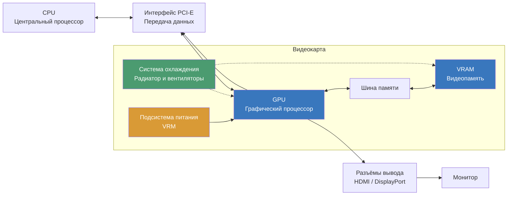
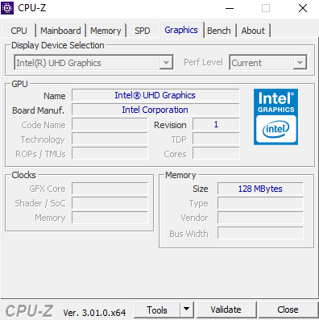
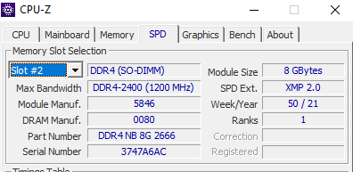
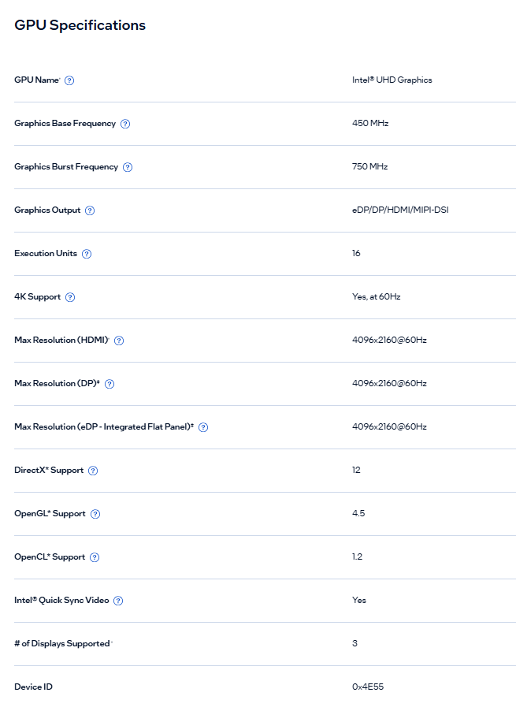
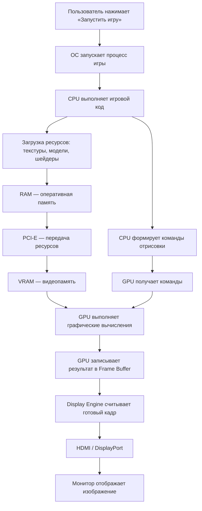

# Домашняя работа по теме GPU и выбор графического ускорителя

## Часть 1. Теория

### 1. Перечислите 5 основных блоков видеокарты и укажите назначение каждого.

1. GPU (Graphics Processing Unit) — графический процессор, выполняет вычисления, обработку графики, текстур и изображений.
2. VRAM (Video Random Access Memory) — видеопамять, хранит текстуры, модели, кадры и другие данные, необходимые GPU.
3. Шина памяти — обеспечивает обмен данными между GPU и VRAM. От её ширины и частоты зависит пропускная способность памяти.
4. Подсистема питания (VRM) — преобразует и стабилизирует напряжение, необходимое для работы GPU и видеопамяти.
5. Система охлаждения — отводит тепло от GPU и других нагревающихся компонентов, предотвращая перегрев.

### 2. Чем GPU отличается от CPU по архитектуре? Приведите 2 отличия и объясните, для каких задач выгоден каждый.

1. Количество вычислительных ядер:

- CPU имеет сравнительно небольшое количество мощных универсальных ядер, которые хорошо справляются со сложными последовательными задачами.
- GPU содержит большое количество более простых вычислительных блоков, способных одновременно выполнять множество операций.

2. Организация вычислений:

- CPU оптимизирован для последовательного выполнения задач, быстрого переключения между ними и обработки сложной логики.
- GPU оптимизирован для параллельной обработки большого количества однотипных операций над разными данными.

Вывод: CPU лучше подходит для работы операционной системы, запуска программ и сложных последовательных вычислений, а GPU — для обработки графики, видео, научных расчётов и нейросетей.

### 3. Что такое VRAM и чем она отличается от оперативной памяти компьютера? Почему видеопамять делают максимально быстрой?

VRAM — это специализированная видеопамять, предназначенная для хранения данных, необходимых графическому процессору: текстур, моделей, кадров изображения и промежуточных результатов вычислений.

Отличия от оперативной памяти (RAM):

- VRAM используется преимущественно графическим процессором, а RAM — центральным процессором и остальными компонентами компьютера.
- VRAM обычно обеспечивает более высокую пропускную способность, чем обычная оперативная память.
- VRAM физически расположена на видеокарте, а RAM устанавливается в слоты материнской платы.

Видеопамять делают максимально быстрой, потому что GPU одновременно обрабатывает огромное количество данных. Высокая пропускная способность позволяет быстрее передавать данные между памятью и графическим процессором, уменьшая ожидание и повышая производительность.

### 4. Объясните своими словами, что такое SIMT (Single Instruction, Multiple Threads) и зачем GPU группирует потоки в варпы.

SIMT (Single Instruction, Multiple Threads) — это принцип работы GPU, при котором одна инструкция одновременно выполняется множеством потоков, но каждый поток обрабатывает свои данные.

GPU группирует потоки в варпы (warps), чтобы эффективнее организовать параллельные вычисления и одновременно выполнять одну инструкцию для группы потоков.

Например, при обработке изображения каждый поток может отвечать за отдельный пиксель, но выполнять одинаковые операции над ним.

Если потоки внутри варпа должны выполнять разные ветви условий, их выполнение может сериализоваться, что снижает производительность.

### 5. Зачем видеокарте система охлаждения и подсистема питания? Что произойдёт, если охлаждение не справится?

Система охлаждения отводит тепло, которое выделяется при работе GPU и видеопамяти. Она может включать радиатор, вентиляторы, тепловые трубки или испарительную камеру.

Подсистема питания (VRM) преобразует напряжение от блока питания и обеспечивает стабильное электропитание GPU и других компонентов видеокарты.

Если охлаждение не справляется:

- Температура компонентов повышается.
- GPU начинает снижать частоту и производительность (троттлинг), чтобы уменьшить нагрев.
- При критическом перегреве видеокарта может аварийно отключиться.
- Длительная работа при чрезмерных температурах может сократить срок службы компонентов.

## Часть 2. Схема

### 6. Упрощённая блок-схема видеокарты

Для схемы использовал Mermaid. Она показывает путь данных от процессора компьютера до монитора, а также вспомогательные компоненты видеокарты.

Пояснение к схеме:

1. CPU передаёт видеокарте команды и необходимые данные через интерфейс PCI-E.
2. GPU получает данные и выполняет графические вычисления.
3. Для работы GPU обращается к VRAM через шину памяти, где хранятся текстуры, кадры и другие необходимые данные.
4. После обработки GPU формирует изображение и передаёт его на разъёмы HDMI или DisplayPort.
5. Монитор получает видеосигнал и отображает изображение.
6. Подсистема питания обеспечивает компоненты необходимым напряжением, а система охлаждения отводит выделяемое тепло.

## Часть 3. Практика

Я делал на старом домшнем ПК.

CPU-Z никакой информации о графике не дала

Но т.к. известен процессор intel N5095, и известно что VRAM выделяется из основной памяти. 
Я сделал снимок информации об основной памяти

* Тип памяти DDR4
* Ширина шины 64 бита (у меня один модуль, одноканальный режим)
* TDP 15 Вт (всего процессора вместе с GPU)
* Пропускная способность памяти 2400 МГц * 64 бит / 8 = 19200 МБ/c примерно 19 ГБ/c
* Максимальная паспортная пропускная сопсобность: 45.8 ГБ/с (достигается при работе памяти DDR4-2933 в двухканальном режиме 128 бит).

Технические данные сайта производителя.

Число ядер (шейдерных): 128 вычислительных блоков (у чипа 16 исполнительных блоков EU, в каждом по 8 физических ALU: 16 × 8 = 128)

### 9. Пошаговый процесс запуска игры

1. Запуск игры (CPU и ОС)

Пользователь нажимает на ярлык игры. ОС запускает исполняемый файл, выделяет память и создаёт процесс.

2. Загрузка ресурсов и подготовка игры (CPU)

CPU выполняет игровой код: загружает уровни, обрабатывает логику игры, физику, действия персонажей и подготавливает игровые объекты.

3. Передача ресурсов в VRAM (RAM → VRAM)

CPU и графический драйвер организуют передачу текстур, моделей, шейдеров и других ресурсов из оперативной памяти в видеопамять через PCI-E.

4. Подготовка команд для GPU (CPU → GPU)

CPU определяет, что нужно отрисовать, и формирует команды отрисовки (Draw Calls). Через графический API (DirectX, Vulkan и другие) команды передаются GPU.

5. Обработка графики (GPU)

GPU выполняет команды: обрабатывает вершины моделей, рассчитывает освещение, обрабатывает текстуры, выполняет растеризацию и формирует пиксели изображения.

6. Формирование готового кадра (GPU → VRAM)

Результат рендеринга записывается в специальную область VRAM — кадровый буфер (Frame Buffer). Там хранится готовое изображение.

7. Вывод изображения (VRAM → монитор)

Контроллер дисплея (Display Engine) считывает данные готового кадра из VRAM и формирует видеосигнал через HDMI или DisplayPort.

## Часть 4. Вывод

### 10. Почему видеокарты оказались нужны не только для игр, но и для ИИ? 

Видеокарты стали использоваться в ИИ, потому что их архитектура хорошо подходит для массовых параллельных вычислений. Нейросети выполняют огромное количество однотипных математических операций, например умножение матриц и сложение чисел. GPU способен одновременно обрабатывать множество таких операций благодаря большому количеству вычислительных блоков. CPU тоже может выполнять эти вычисления, но обычно уступает GPU по производительности в подобных параллельных задачах. Поэтому видеокарты значительно ускоряют обучение и работу нейросетей.