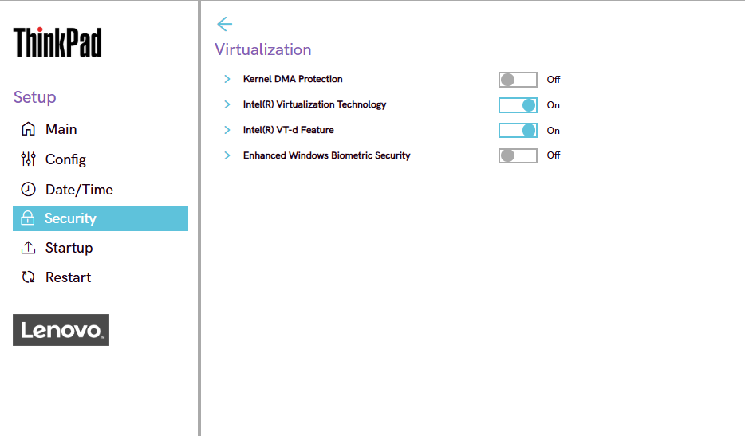
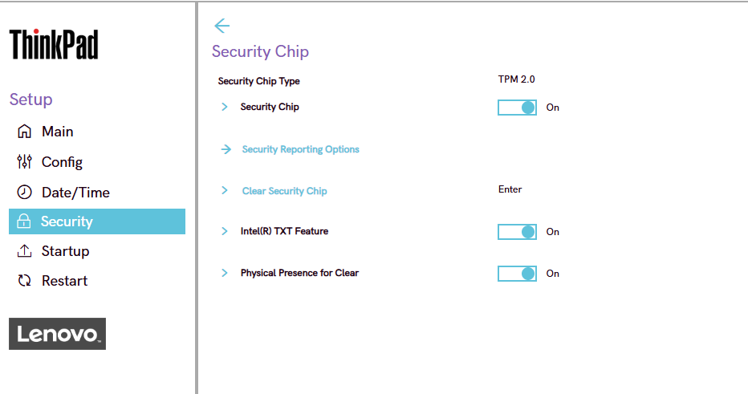
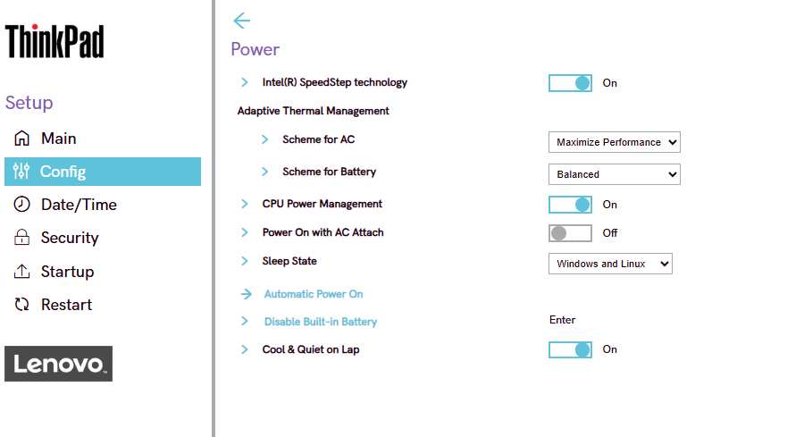
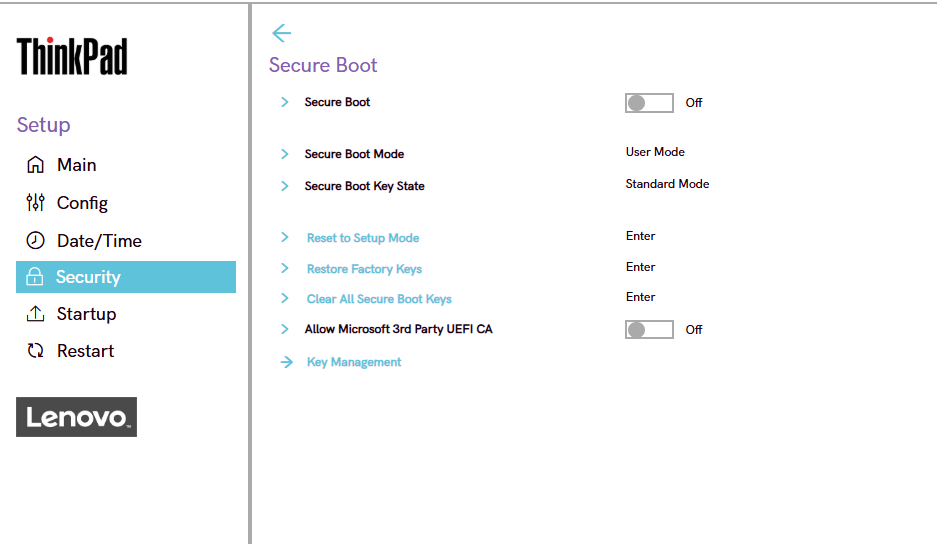
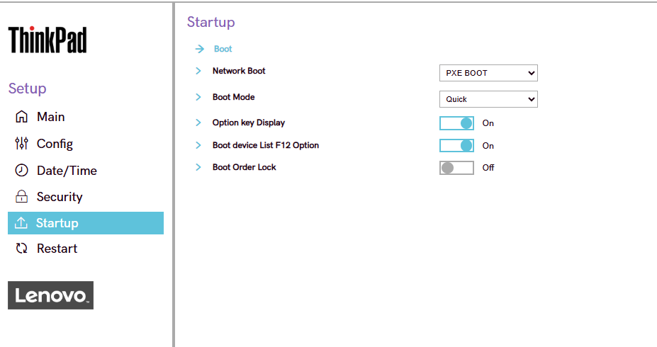
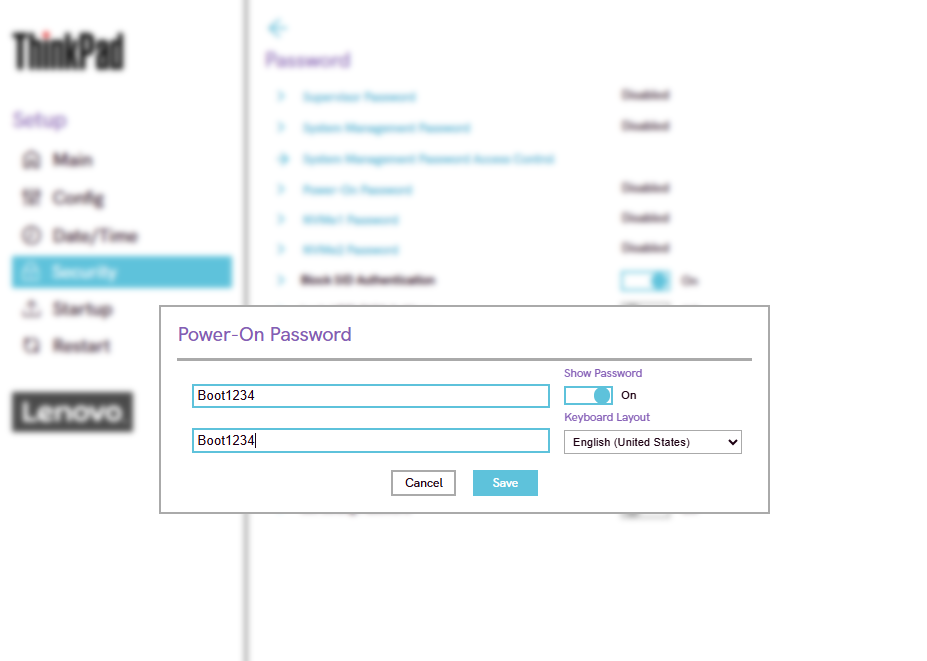
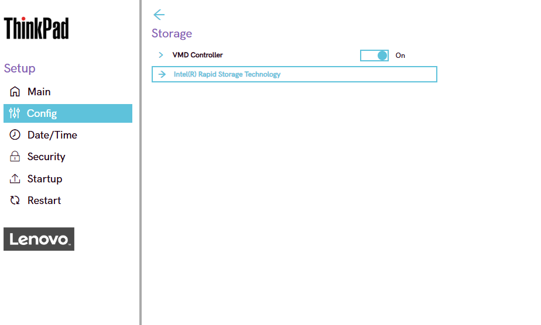
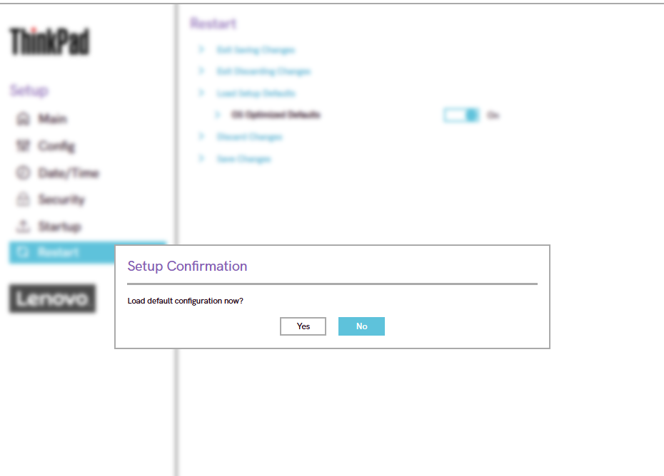

# Домашняя работа по теме UEFI/BIOS диагностика и загрузка

Модель: ThinkPad X1 Extreme Gen 5 (21DE, 21DF)
Среда выполнения: Lenovo BIOS Simulator Center
Версия UEFI BIOS: N3JHTXXW (2021-12-16)

---

## Задача 1. Включение аппаратной виртуализации (Intel VT-x / AMD-V)

**Путь:** Security → Virtualization.

**Зачем нужна виртуализация:** VT-x позволяет процессору аппаратно изолировать виртуальные машины и выполнять гостевой код почти без потерь производительности. Без неё VMware, Hyper-V, VirtualBox (в режиме 64-бит гостей) и эмулятор Android работают медленно или не запускаются совсем.

---

## Задача 2. Проверка статуса TPM и его связь с BitLocker

**Путь:** Security → Security Chip.

**Что такое TPM:** аппаратный криптомодуль (на современных ноутбуках встроен в процессор или чипсет как Intel PTT), который хранит ключи шифрования и проверяет целостность цепочки загрузки.

**Связь с BitLocker:** BitLocker хранит ключ шифрования тома в TPM и выдаёт его только при неизменённой конфигурации загрузки. При отключении или очистке TPM ключ становится недоступен, и при следующей загрузке Windows потребует 48-значный ключ восстановления BitLocker. Если ключа восстановления нет, доступ к данным на диске потерян. Поэтому перед отключением TPM BitLocker нужно приостановить или расшифровать диск.

---

## Задача 3. Настройка поведения при потере питания (After Power Loss)

**Путь:** Config → Power
В ноутбуках обычно такой настройки нет, потому что у них есть аккумулятор.

**Разница между режимами:**

| Режим | Поведение после возврата питания |
|---|---|
| Power Off | Остаётся выключенным, пока пользователь не нажмёт кнопку питания |
| Power On | Включается автоматически, независимо от прежнего состояния |
| Last State | Возвращается в состояние, в котором был перед пропаданием питания (работал → включится, был выключен → останется выключенным) |

**Для сценария «сервер в удалённой стойке»:** подходит Power On (либо Last State). Администратор не может нажать кнопку питания физически, поэтому после сбоя электричества машина должна включиться сама.

---

## Задача 4. Отключение Secure Boot и проверка последствий

**Путь:** Security → Secure Boot → Secure Boot.

**Где отображается статус:** в том же разделе Security → Secure Boot (поля Secure Boot Mode и Secure Boot Key State). Дополнительно в этом разделе есть пункты Reset to Setup Mode, Restore Factory Keys, Clear All Secure Boot Keys, Allow Microsoft 3rd Party UEFI CA (сейчас Off) и Key Management.

**Когда нужно отключать Secure Boot:**

1. Загрузка с неподписанного загрузочного USB (утилиты диагностики, самосборные образы).
2. Установка дистрибутивов Linux или другой ОС, загрузчик которых не подписан доверенным ключом. Для части дистрибутивов вместо отключения достаточно включить `Allow Microsoft 3rd Party UEFI CA`.

Также отключение может понадобиться при использовании некоторых сторонних драйверов ядра (например, проприетарных модулей).

**Последствия:** прошивка перестаёт проверять подписи загрузчика, поэтому возрастает риск запуска буткитов и другого вредоносного кода до старта ОС.

---

## Задача 5. Настройка порядка загрузки через Fast Boot

**Путь:** Startup → Boot Mode (в этой модели аналог Fast Boot: режимы Quick и Diagnostics).

**Почему при Fast Boot компьютер иногда «не видит» флешку:** в быстром режиме прошивка пропускает часть проверок и инициализирует только устройства из текущего порядка загрузки. USB-контроллеры и подключённые устройства могут не успеть инициализироваться, а окно для нажатия F12 становится очень коротким. Поэтому для загрузки с флешки Fast Boot отключают или заходят в меню загрузки сразу после включения.

---

## Задача 6. Установка пароля на включение (Power-On Password)

**Путь:** Security → Password → Power-On Password.

**Разница между паролями:**

| Пароль | Когда запрашивается | Для чего нужен |
|---|---|---|
| Power-On Password | При каждом включении, до загрузки ОС | Физическая защита: без него устройством нельзя пользоваться |
| Supervisor Password | При входе в настройки BIOS | Защита настроек от изменения посторонними; нужен администратору |

Power-On Password подходит обычному пользователю для защиты устройства. Supervisor Password нужен ИТ-администратору, чтобы пользователь не мог менять критичные параметры (Secure Boot, порядок загрузки, виртуализацию).

---

## Задача 7. Настройка SATA Controller Mode для установки ОС

**Путь:** Config → Storage → .

В этом ноутбуке нет настройки ACHI/IDE, можно только включить raid.

**Почему после смены режима Windows может не загрузиться:** драйвер контроллера выбирается при установке ОС. Если Windows установлена в режиме AHCI, а в BIOS включили RAID/Intel RST, она не находит драйвер нужного контроллера, не видит системный диск и выдаёт ошибку вида INACCESSIBLE_BOOT_DEVICE. Верно и обратное. Это же объясняет, почему установщик Windows иногда «не видит» диск, пока не загружен драйвер Intel RST.

---

## Задача 8. Просмотр и очистка системного журнала событий (Event Log)

Скриншота для этой задачи нет. В симуляторе раздел Main содержит пункт `BIOS Event log` со значением `(Simulator not support)`, то есть просмотр и очистка журнала в симуляторе недоступны.

**Где искать журнал на реальном устройстве:** Main → BIOS Event log (или Config → Diagnostics, в зависимости от модели) → просмотр записей и опция Clear Event Log.

**Какие события обычно фиксируются:** ошибки POST, изменения конфигурации BIOS, смена паролей, события безопасности (вскрытие корпуса, сброс TPM), ошибки памяти и питания.

**Зачем очищать журнал перед передачей устройства:** чтобы новый владелец не получил историю работы предыдущего (какие настройки менялись, какие ошибки были), и чтобы новые события не смешивались со старыми при диагностике.

---

## Задача 9. Восстановление заводских настроек с сохранением пользовательских данных

**Путь:** Restart → Load Setup Defaults

**Путь 2:** Security → Reset system to Factory Default (сброс не выполнялся).

**Разница между опциями:**

| Опция | Что делает | Когда использовать |
|---|---|---|
| Load Setup Defaults | Возвращает значения параметров BIOS к умолчанию; пароли, ключи и данные не затрагиваются | Рабочий сброс, когда после экспериментов с настройками устройство ведёт себя неправильно |
| Reset system to Factory Default | Полный сброс: ключи безопасности, пароли, состояние защитных модулей. Требует предварительно отключить Absolute Persistence и снять пароли NVMe | Подготовка устройства к передаче, продаже или возврату на склад |

---

## Задача 10. Полный сценарий: подготовка нового сотрудника (IT-администратор)

Сценарий выполнен последовательно:

1. **Аппаратная виртуализация:** Security → Virtualization → Intel Virtualization Technology → Enabled.
2. **TPM:** Security → Security Chip → Enabled.
3. **Power-On Password:** Security → Password → Power-On Password, пароль `Boot1234`.
4. **Fast Boot:** Startup → Boot Mode → отключён быстрый режим (чтобы сотрудник мог загрузиться с USB).
5. **After Power Loss:** Config → Power → After Power Loss → Power On.
6. **Сохранение:** F10, повторный вход. Все настройки проверены: **[ЗАПОЛНИ: сохранились / что не сохранилось]**. После проверки сброшен пароль и возвращён Fast Boot.

**Итог:** рабочая станция защищена паролем и TPM, готова к запуску виртуальных машин, допускает загрузку с USB и автоматически включается после сбоя питания.
